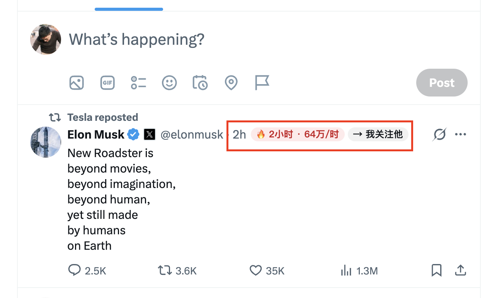
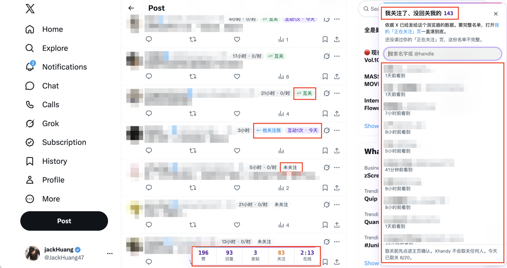

# Xhandy

Browser helpers for people who engage on X by hand.

> Xhandy is an independent project. It is not affiliated with, endorsed by or sponsored by X Corp.

**Xhandy never acts for you.** It does not click, type, send, like, follow or schedule anything.
It reads the page and your own actions, shows hints, and keeps all data in your browser.
That is the point: you get faster without anything that looks like a bot to X.

## Features (v0.4)

- **Post badges**: how old each post is (posts older than 48 h are greyed out, since replying there rarely helps),
  how many times you have interacted with the author and when, and a highlight for accounts you choose.
- **Post heat**: the age badge also shows views per hour since posting (`2h · 15K/h`) and turns orange
  from 1,000/h and red with 🔥 from 10,000/h, so you can see at a glance which posts are worth joining.
  The view count is the one X already sent with the post; posts under 30 minutes old count as 30 minutes
  so a few early views don't look like a spike. Thresholds are in Options.
- **Reply signals**: `💬 23 · 46K followers · 12×` shows how many replies a post already has, how many
  followers its author has, and how much bigger the author is than you, so you can pick posts where a reply
  gets seen. `✓ replied` marks posts you already replied to, also from another device once X has shown your
  reply in this browser. Both come from data X already sent and each can be turned off in Options.
- **Follow relationship**: each post shows whether you and the author follow each other
  (⇄ mutual, → you follow, ← follows you, not following). It is read from the data X already sends
  to your browser while you scroll; Xhandy makes no extra requests. Display only: it never follows or
  unfollows anyone.
- **Not following you back** (`Alt+U`, or the button in the toolbar popup): a panel on the right listing
  accounts you follow that don't follow you, with search. Built from the same data; for the full list, open your
  own Following page and scroll to the bottom once. Read-only on purpose: each row only links to the profile,
  there is no unfollow button and no bulk action. Unfollows you make by hand on X are counted, with a reminder
  above a soft daily limit (default 20). If none of the accounts you follow shows as following you back,
  the panel warns that X may have changed its data instead of showing a misleading list.
- **Follow assistant** (`Shift+F` on a post selected with `j`/`k`): finds the author's own Follow button
  (already on the page, e.g. in a hover card you opened by pointing at the author, or else on the author's
  profile) and focuses it. You press `Enter` to follow or `Esc` to cancel (`Alt+←` returns from the profile);
  Xhandy never clicks it and never fakes mouse events.
  Counts follows per day and reminds you above a soft daily limit (default 20), because following fast is
  what gets accounts limited. Follows and unfollows are counted when X confirms them, so every way of
  following counts (Follow buttons, a post's ⋯ menu, ...) and failed ones don't.
- **Duplicate-reply warning**: while you type, warns if the reply is very similar to one you sent recently,
  or if you are about to send the same short reply ("great!", "加油") for the third time.
  Repetitive replies are what spam filters look for.
- **Daily stats**: a small bar with today's likes, replies, posts and time on X, plus an optional daily reply goal.
  `Alt+H` hides it, and it fades while you scroll. The toolbar popup shows the last 7 days.
- **Looks at home on X**: post badges use X's own colours and follow its Default, Dim and Lights out themes.
  Xhandy's own surfaces (stats bar, panel, toasts, popup) share one look: X's shapes with a cyan-violet-pink
  top edge and monospace numbers, and a progress bar for the daily reply goal. Overlays ignore the mouse
  (`pointer-events: none`), so they never block a click on X.

X's own shortcuts already cover navigation and actions (`j`/`k`, `l` like, `r` reply, `t` repost, `?` for the list),
so Xhandy does not replace them.

## Install (unpacked)

1. Download `xhandy-<version>.zip` from the [latest release](https://github.com/jackxlabs/xhandy/releases/latest) and unzip it.
   Put the `xhandy` folder somewhere it can stay: Chrome loads it from there every time.
2. Open `chrome://extensions` (Chrome, Chromium, Edge, Brave), turn on **Developer mode**.
3. Click **Load unpacked** and choose the `xhandy` folder (the one with `manifest.json` in it).
4. Open x.com. Settings are under the extension's **Options**.

To update, unzip the new release over the same folder and click reload on Xhandy in `chrome://extensions`.
Keep the folder where it is: the extension ID, and with it your data, is tied to the folder's path.

## Privacy

- Permissions: `storage` and `unlimitedStorage` (so a long follow list never hits Chrome's 10 MB cap).
  Scripts run on `x.com` and `twitter.com` only.
- Stored in this browser only: your settings, daily counts, per-author like/reply counts, follow relationships,
  the text of your last 300 replies and posts (used for the duplicate-reply warning), the ids of up to 5,000
  posts you replied to (for the `✓ replied` mark), and your own handle and follower count.
- `src/page-hook.js` runs in the page so it can read X's own API responses (follow relationships,
  view counts, and X's answers to your own follows, unfollows, posts and replies). It clones responses and never
  changes or sends anything. A reply or post is recorded only after X confirms it was created.
- No network requests, no analytics, no remote code.
- Export, import or delete everything from the Options page.

The full privacy policy is in [PRIVACY.md](PRIVACY.md).

## Feedback

Ideas, bugs, things that feel off: message me on X at [@JackHuang47](https://x.com/JackHuang47), no GitHub account needed.
A screenshot and the page you were on help most, since X changes its pages often.
If you use GitHub, [issues](https://github.com/jackxlabs/xhandy/issues) work too.

## Roadmap

- v0.5: interaction queue (open the next post to reply to with a shortcut), save posts to a local idea list,
  draft prefill for quote posts (you still press send), export and a generic webhook.
- v0.6: optional Notion sync, Chinese/English UI polish, store listing.

## Development

```sh
npm install
npm test                                   # unit tests
CHROMIUM=/usr/bin/chromium npm run e2e     # loads the extension against a fake timeline, never touches real X
```

X changes its markup often. Selectors live at the top of `src/content.js` (`SEL`), based on `data-testid` attributes.

## 中文说明

Xhandy 是给“手动玩 X”的人用的浏览器插件：标出帖子发了多久和每小时浏览量（每小时 1000 以上标橙，1 万以上标红 🔥，一眼看出哪条正火、值得跟进）、你和作者是否互关、互动过几次，选中帖子按 Shift+F 选中作者的「关注」按钮（页面上有就直接选中，比如你自己把鼠标移到作者头像上弹出的资料卡；没有就跳到作者主页再选中。你按 Enter 才会关注，插件不模拟鼠标），按 Alt+U 在右侧列出「我关注了、但没回关我」的账号（只读，没有取关按钮，取关要自己去对方主页点，超过每日软上限会提醒），打字时提醒“这条回复和你刚发过的很像”，统计今天的点赞、回复、发帖、关注、取关数和在线时长（关注和取关以 X 确认成功为准，从关注按钮、帖子「⋯」菜单等任何入口操作都算）。

它**不会替你做任何操作**：不点击、不输入、不发送、不点赞、不关注。只读取页面和你自己的操作，数据只存在你的浏览器里。

Xhandy 是独立项目，与 X Corp. 没有任何关联，也未获其认可或赞助。

### 安装

1. 到 [Releases 页面](https://github.com/jackxlabs/xhandy/releases/latest)下载最新的 `xhandy-版本号.zip` 并解压，得到一个 `xhandy` 文件夹。把它放在一个以后不会动的位置，浏览器每次都从这里加载。
2. 在 Chrome、Edge 或 Brave 的地址栏打开 `chrome://extensions`，打开右上角的**开发者模式**。
3. 点**加载已解压的扩展程序**，选择 `xhandy` 文件夹（里面有 `manifest.json` 的那一层）。
4. 打开 x.com 刷新一下，底部出现一条统计栏就说明装好了。建议把 Xhandy 固定到工具栏，方便打开弹窗。

更新：下载新版本的 zip，解压覆盖原来的文件夹，再到 `chrome://extensions` 点 Xhandy 的「重新加载」。**不要换文件夹位置**：扩展 ID 跟着文件夹路径走，换了位置，原来的数据就读不到了。要换的话先在设置页导出数据，换完再导入。

### 怎么用

装好后不用做任何设置，正常刷 X 就行：



- **帖子标记**：每条帖子作者名旁边会多几个小标签：
  - 发了多久和每小时浏览量，例如 `2小时 · 1.5万/时`。每小时 1000 以上变橙，1 万以上变红并带 🔥，说明这条正在火，值得去回复；超过 48 小时的帖子会变灰，回复了也很少有人看到。
  - 你和作者的关注关系：`⇄ 互关`、`→ 我关注他`、`← 他关注我` 或 `未关注`。
  - 你和这个作者互动过几次、最近一次是什么时候，例如 `互动3次 · 今天`。
  - 帖子已有多少回复、作者有多少粉丝、作者是你的几倍，例如 `💬 23 · 4.6万粉 · 12×`，方便挑回复了能被看到的帖子。
  - 你已经回复过的帖子标 `✓ 已回复`，在别的设备上回复的，只要 X 在这个浏览器里显示过你的回复，也会标出来。

  这两项都用 X 本来就发给浏览器的数据，可以在设置里分别关掉。

  浏览器语言是中文时界面显示中文，否则显示英文。



- **防重复回复**：写回复时如果和你最近发过的某条很像，或者同一句短回复（比如「加油」）要发第三次了，右下角会提醒。重复的回复最容易被当成垃圾内容。
- **今日统计**：页面底部的小条显示今天的点赞、回复、发帖、关注数和在线时长，滚动时会变淡。点工具栏上的 Xhandy 图标可以看最近 7 天。

### 快捷键

| 按键 | 作用 |
|---|---|
| `j` / `k` | X 自带：选中下一条 / 上一条帖子 |
| `Shift+F` | 关注助手：找到选中帖子作者的「关注」按钮并让它获得焦点。页面上已有就直接用（比如你把鼠标移到作者头像上弹出的资料卡），没有就跳到作者主页 |
| `Enter` / `Esc` | 关注助手出现后：按 `Enter` 关注，按 `Esc` 取消。插件自己永远不会点 |
| `Alt+←` | 浏览器自带的后退：关注助手跳到作者主页后，用它回到时间线 |
| `Alt+U` | 打开或关闭「没回关我」列表，可以搜索，`Esc` 关闭 |
| `Alt+H` | 隐藏或显示底部统计栏 |

Mac 上的 `Alt` 就是 `Option` 键。X 自带的快捷键（`l` 点赞、`r` 回复、`t` 转发、`?` 查看全部）照常可用，Xhandy 不会占用它们。

**「没回关我」列表**用的是你刷 X 时已经加载过的数据。想要完整名单，先打开自己主页的「正在关注」页面，一直滚到底，再按 `Alt+U`。列表只能看，没有取关按钮：要取关的话点进对方主页自己操作，每天取关超过 20 个会提醒你。

### 设置

在 `chrome://extensions` 里点 Xhandy 的「详细信息 → 扩展程序选项」，或者右键工具栏图标 →「选项」。可以调：

- 要高亮的账号（每行一个用户名）
- 多少小时算旧帖、多少浏览量算「热」和「火」
- 每天关注、取关的提醒上限（默认各 20 个，只提醒，不拦截）
- 防重复回复的灵敏度
- 是否显示回复数和作者体量、是否标记已回复的帖子
- 每日回复目标（统计栏会显示进度条）
- 导出、导入、清空全部数据

### 反馈

有想法、遇到问题、觉得哪里别扭，直接在 X 上私信我 [@JackHuang47](https://x.com/JackHuang47)，不需要 GitHub 账号。
最好附一张截图，说明当时在哪个页面：X 经常改版，截图能最快找到问题。用 GitHub 的话也可以提 [issue](https://github.com/jackxlabs/xhandy/issues)。

## License

MIT
