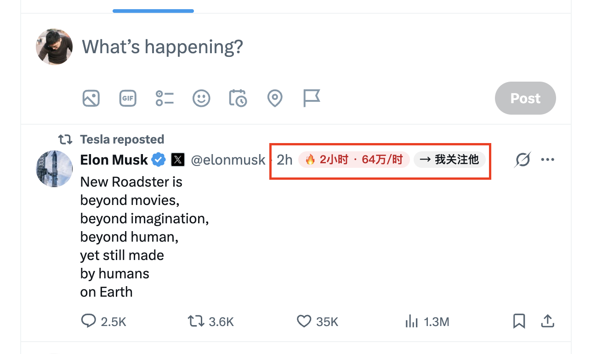
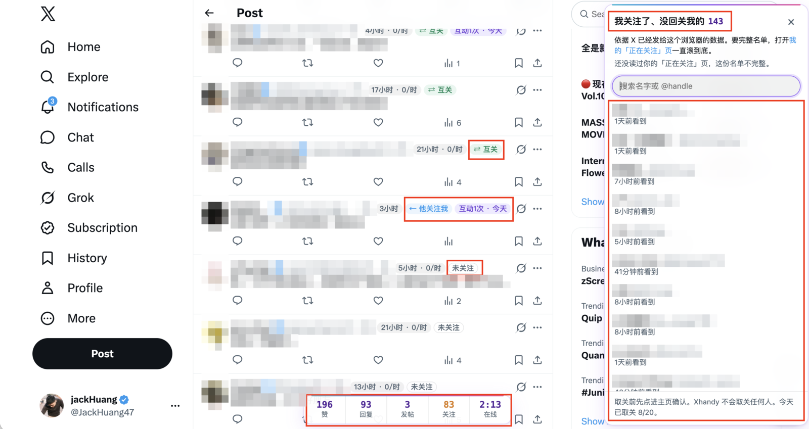

# Xhandy

Browser helpers for people who engage on X by hand.

> Xhandy is an independent project. It is not affiliated with, endorsed by or sponsored by X Corp.

**Xhandy never acts for you.** It does not click, type, send, like, follow or schedule anything.
It reads the page and your own actions, shows hints, and keeps all data in your browser.
That is the point: you get faster without anything that looks like a bot to X.

## Features

- **Feature switches and autosave**: every feature (heat chip, heat colouring, interaction chips, interaction tint, reply signals, replied mark, relationship chip, key accounts, top posts, notes, duplicate-reply warning, follow/unfollow reminders, and stats bar) has an on/off switch in its own section in Options. All changes save automatically as you make them (no Save button needed). All are on by default.
- **Notes** (`Alt+N`, or the button on profiles): keep private notes, tags and relationship stages for any account. Choose from four status presets (To reach out, In touch, Regular, Working together), up to 5 tags, and up to 500 characters of text. Posts by that account show a status chip or `#tag` next to the author's name (hover to preview the note). Manage, search and filter all notes in Options. Data is stored strictly in your browser and never leaves.
- **Top posts** (`Alt+B`, or the button on profiles): opens X's own search for an account's best-received original posts (`from:<handle> min_faves:<N> -filter:replies`), with the threshold N chosen from their follower count; the browser's Back button returns to the profile. Helps you find winning topics and opening lines without typing search queries by hand. Turn it off in Options.
- **Language**: English or Chinese, chosen at the top of Options (default: follow the browser language). It applies to the settings page, the toolbar popup and every hint on x.com, without reloading X.
- **Key accounts** (`Alt+K`, or the button in the toolbar popup): star accounts you care about directly from post badges (`☆` to star, `★` when starred) or with `Alt+S` on the post selected with `j`/`k`. Their posts get a blue edge, and the filled `★` is the only marker; click it again to unstar. A dedicated panel (`Alt+K`) lists your key accounts sorted by silence (accounts with no recent interaction in either direction first) and marks quiet accounts (default 14 days without interaction in either direction, threshold customizable in Options). You can also manage key accounts in Options with search, added dates, last interaction dates, one-click removal, and bulk paste-to-add.
- **Post badges**: how many times you have interacted with the author and when (`1× · 2d ago`), and a highlight for accounts you choose.
  Once the author has interacted with you too, the chip shows both sides: `you 3 · them 5 · today` (likes,
  replies, quotes and mentions they gave you, from your notifications and the posts X shows you; each counted
  once). Turn the second half off in Options. The badge sits next to the author's name and moves
  above the post text when it does not fit. When a list shows a post again (going back, scrolling back),
  the badge keeps the place it had, so the list doesn't jump; chips added since then may be cut off.
- **Interaction tint**: posts by people you interact with in both directions get a light violet background, deeper with more two-way interactions (the smaller side counts), fading by half every 30 days without interaction, shown without hovering. Counts come from what X showed in this browser. Settings and switch in Options.
- **Post heat**: views per hour since posting (`15K/h`, `🔥 950K/h`).
  Turns orange from 1,000/h and red with 🔥 from 10,000/h, so you can see at a glance which posts are worth joining.
  Old posts (older than 48 h) are greyed out with an "old post" mark (`694/h · old post`). A recent post with no view
  data shows no heat chip. The view count is the one X already sent with the post; posts under 30 minutes old count as
  30 minutes so a few early views don't look like a spike. Thresholds are in Options.
- **Reply signals**: `💬 23 · 12×` shows how many replies a post already has and, when the author is at least twice
  your size, how many times bigger, so you can pick posts
  where a reply gets seen. `✓ replied` marks posts you already replied to, also from another device once X has shown
  your reply in this browser. Both come from data X already sent and each can be turned off in Options.
  Your own posts only show heat and the reply count: no relationship or interaction chip.
- **Follow relationship**: each post shows whether you and the author follow each other
  (`⇄ mutual`, `→ you follow`, `← follows you`). When neither follows the other, no chip is shown. It is read from
  the data X already sends to your browser while you scroll; Xhandy makes no extra requests. Display only: it never
  follows or unfollows anyone.
- **Not following you back** (`Alt+U`, or the button in the toolbar popup): a panel on the right listing
  accounts you follow that don't follow you, with search. Built from the same data; for the full list, open your
  own Following page and scroll to the bottom once. Read-only on purpose: each row only links to the profile,
  there is no unfollow button and no bulk action. Unfollows you make by hand on X are counted, with reminders
  above a soft daily limit (default 20) or when you unfollow too quickly within a window (default over 10 in 60 minutes). If none of the accounts you follow shows as following you back,
  the panel warns that X may have changed its data instead of showing a misleading list.
  Each row shows the account's follower and following counts when X provided them (e.g. `12K followers · 310 following`), so you can gauge account size and activity at a glance without opening each profile; counts X never sent stay absent. The panel stays open across page loads in the same tab (after opening a profile, reloading, or using Back) with your search text and scroll position preserved.
  Mutuals who stop following you back are listed on top under "Recently unfollowed you", newest first, with when
  Xhandy noticed and when you were last seen as mutuals. It notices from the same data as you browse (no extra
  requests), so it only catches accounts X shows you again. Unfollows you make yourself never show up there.
  `×` moves an account down into the normal list.
- **Follow assistant** (`Shift+F` on a post selected with `j`/`k`): finds the author's own Follow button
  (already on the page, e.g. in a hover card you opened by pointing at the author, or else on the author's
  profile) and focuses it. You press `Enter` to follow or `Esc` to cancel (`Alt+←` returns from the profile);
  Xhandy never clicks it and never fakes mouse events.
  Counts follows per day and reminds you above a soft daily limit (default 20) or when you follow too quickly
  within a window (default over 10 in 60 minutes), because following fast is
  what gets accounts limited. Follows and unfollows are counted when X confirms them, so every way of
  following counts (Follow buttons, a post's ⋯ menu, ...) and failed ones don't.
- **Duplicate-reply warning**: while you type, warns if the reply is very similar to one you sent recently,
  or if you are about to send the same short reply ("great!", "加油") for the third time.
  Repetitive replies are what spam filters look for.
- **Daily stats**: a rounded pill in the bottom-right corner with today's likes, replies, posts, follows and time on X, plus an optional daily reply goal. It sits where it won't cover the reply box, and you can drag it anywhere in the window (clamped inside on resize; position saved locally and can be reset in Options). `Alt+H` hides it, and it fades while you scroll.
- **Toolbar popup**: today's five numbers, a 7-day replies bar chart with weekly total and daily average, quick-access rows for Key accounts (with quiet count and `Alt+K`) and Not following back (with count and `Alt+U`), and an Options button.
- **Looks at home on X**: post badges use X's own colours and follow its Default, Dim and Lights out themes.
  Xhandy's own surfaces (stats bar, panels, toasts, popup, settings) share one neutral look matching X, stroke SVG icons, and proportional numbers with tabular figures. Toasts ignore the mouse
  (`pointer-events: none`), so they never block a click on X; the stats bar takes the mouse only so you can drag it.

X's own shortcuts already cover navigation and actions (`j`/`k`, `l` like, `r` reply, `t` repost, `?` for the list),
and Xhandy adds `Alt+S` (star/unstar selected post's author), `Alt+B` (top posts search), `Alt+N` (edit note), `Alt+K` (key accounts panel), `Alt+U` (not following you back panel), `Shift+F` (follow assistant), and `Alt+H` (toggle stats bar).

## Install

Install Xhandy from the [Chrome Web Store](https://chromewebstore.google.com/detail/xhandy/ddchjfknionekeplnehokjbngoeccaan). It works in Chrome, Edge and Brave, and updates by itself.

**Moving from the unpacked version:** the store version has a different extension ID, so it can't see the old
version's data. In the old version's Options, export your data; install from the store; import the file in the
new version's Options; then remove the old one in `chrome://extensions`, or both will badge and count every post.

### Install unpacked (optional)

1. Download `xhandy-<version>.zip` from the [latest release](https://github.com/jackxlabs/xhandy/releases/latest) and unzip it.
   Put the `xhandy` folder somewhere it can stay: Chrome loads it from there every time.
2. Open `chrome://extensions` (Chrome, Chromium, Edge, Brave), turn on **Developer mode**.
3. Click **Load unpacked** and choose the `xhandy` folder (the one with `manifest.json` in it).
4. Open x.com. Settings are under the extension's **Options**.

To update, unzip the new release over the same folder and click reload on Xhandy in `chrome://extensions`.
Keep the folder where it is: the extension ID, and with it your data, is tied to the folder's path.

## Privacy

- Permissions: `storage` and `unlimitedStorage` (so a long follow list never hits Chrome's 10 MB cap).
  Scripts run on `x.com` and `twitter.com` only.
- Stored in this browser only: your settings (including the stats bar position), daily counts (likes, replies, posts, follows, unfollows, time on X, and a daily follower count snapshot when X sends it), per-author like/reply counts, follow relationships
  (with when an account was last seen as a mutual, when it stopped following you back, when you dismissed that, and follower/following counts when X sends them),
  timestamps of up to 100 recent follows and 100 recent unfollows (dropped after 24 hours, used for pace reminders),
  the text of your last 300 replies and posts (used for the duplicate-reply warning), the ids of up to 5,000
  posts you replied to (for the `✓ replied` mark), your own handle and follower count, how often each account
  liked, replied to, quoted or mentioned you, up to 20,000 ids of those interactions so each is counted once,
  up to 1,000 key accounts you starred, with the time each was added, up to 5,000 private notes you wrote about accounts (status, tags, text, and when each was created and last edited), and up to 2,000 records of your own posts and replies (post id, reply or post kind, created time, account replied to, the first 80 characters of your text, latest views/likes/reply count and when received, and reply context such as parent creation time, parent author followers, your followers, and parent views per hour; oldest by creation time dropped first, used for the Review view).
- In tab session storage (`sessionStorage`): panel open state (view, search text, scroll position) across reloads within the same tab, cleared when the panel or tab is closed.
- `src/page-hook.js` runs in the page so it can read X's own API responses (follow relationships,
  view counts, and X's answers to your own follows, unfollows, posts and replies). It clones responses and never
  changes or sends anything. A reply or post is recorded only after X confirms it was created.
- No network requests, no analytics, no remote code.
- Export, import or delete everything from the Options page.

The full privacy policy is in [PRIVACY.md](PRIVACY.md).

## Feedback

Ideas, bugs, things that feel off: message me on X at [@JackHuang47](https://x.com/JackHuang47), no GitHub account needed.
A screenshot and the page you were on help most, since X changes its pages often.
If you use GitHub, [issues](https://github.com/jackxlabs/xhandy/issues) work too.

## Roadmap

- Never: auto-follow, auto-reply, auto-like, bulk actions, or posting anything you haven't read and confirmed.

## Development

```sh
npm install
npm test                                   # unit tests
CHROMIUM=/usr/bin/chromium npm run e2e     # loads the extension against a fake timeline, never touches real X
```

X changes its markup often. Selectors live at the top of `src/content.js` (`SEL`), based on `data-testid` attributes.

## 中文说明

Xhandy 是给“手动玩 X”的人用的浏览器插件：标出帖子每小时浏览量（每小时 1000 以上标橙，1 万以上标红 🔥，一眼看出哪条正火、值得跟进；旧帖标灰）、你和作者是否互关、互动过几次，双方来回互动的作者帖子带淡紫色底色（来回互动越多底色越深，以较少一方为准，无互动每 30 天淡化一半，无需悬停直接显示，互动数来自本浏览器内 X 显示过的数据；可在设置中调节或关闭），在帖子上点击 ☆ 或按 Alt+S 将作者设为重点账号（帖子显示蓝色边线，星星变成实心 ★，再点一次取消），按 Alt+K 打开重点账号面板（按最久未互动排序并标出沉寂账号），在别人主页点击「备注」或按 Alt+N 打开账号备注编辑器（设置待破冰、已破冰、常互动、合作中 4 种状态，添加标签和 500 字私密备忘，并在帖子上显示状态或标签角标），选中帖子按 Shift+F 选中作者的「关注」按钮（页面上有就直接选中，比如你自己把鼠标移到作者头像上弹出的资料卡；没有就跳到作者主页再选中。你按 Enter 才会关注，插件不模拟鼠标），按 Alt+U 在右侧列出「我关注了、但没回关我」的账号（只读，没有取关按钮，X 有提供时显示对方的粉丝数与关注数，在同标签页内跳转主页、刷新或后退保持展开并记住滚动位置，取关要自己去对方主页点，超过每日软上限或短时间内取关过快会提醒；原来互关、后来取关你的人排在最上面「最近取关了你」一栏），打字时提醒“这条回复和你刚发过的很像”，关注太快或超过每日上限时提醒防限流，右下角统计条记录今天的点赞、回复、发帖、关注、取关数和在线时长（可自由拖拽，位置随窗口调整自适应，设置页可重置；关注和取关以 X 确认成功为准，从关注按钮、帖子「⋯」菜单等任何入口操作都算），在别人主页点击「高赞帖」或按 Alt+B 一键搜索该博主的高赞原创推文（在当前页打开，按浏览器的后退回到主页）。每个功能都可以在设置页对应的分区里开启或关闭（默认全开），改动自动保存。

它**不会替你做任何操作**：不点击、不输入、不发送、不点赞、不关注。只读取页面和你自己的操作，数据只存在你的浏览器里。

Xhandy 是独立项目，与 X Corp. 没有任何关联，也未获其认可或赞助。

### 安装

到 [Chrome 应用商店](https://chromewebstore.google.com/detail/xhandy/ddchjfknionekeplnehokjbngoeccaan)安装，Chrome、Edge、Brave 都能用，之后会自动更新。

**原来用解压版的：** 商店版的扩展 ID 不一样，读不到原来的数据。先在旧版的设置页导出数据，再从商店安装，在新版的设置页导入，最后到 `chrome://extensions` 删掉旧版。不删的话两个会同时运行，每条帖子都会重复标记、重复计数。

#### 解压安装（可选）

1. 到 [Releases 页面](https://github.com/jackxlabs/xhandy/releases/latest)下载最新的 `xhandy-版本号.zip` 并解压，得到一个 `xhandy` 文件夹。把它放在一个以后不会动的位置，浏览器每次都从这里加载。
2. 在 Chrome、Edge 或 Brave 的地址栏打开 `chrome://extensions`，打开右上角的**开发者模式**。
3. 点**加载已解压的扩展程序**，选择 `xhandy` 文件夹（里面有 `manifest.json` 的那一层）。
4. 打开 x.com 刷新一下，右下角出现一条统计条就说明装好了。建议把 Xhandy 固定到工具栏，方便打开弹窗。

更新：下载新版本的 zip，解压覆盖原来的文件夹，再到 `chrome://extensions` 点 Xhandy 的「重新加载」。**不要换文件夹位置**：扩展 ID 跟着文件夹路径走，换了位置，原来的数据就读不到了。要换的话先在设置页导出数据，换完再导入。

### 怎么用

装好后不用做任何设置，正常刷 X 就行：



- **帖子标记**：每条帖子作者名旁边会多几个小标签：
  - 每小时浏览量，例如 `1.5万/时` 或 `🔥 1.5万/时`。每小时 1000 以上变橙，1 万以上变红并带 🔥；超过 48 小时的帖子会变灰并标「旧帖」，没有浏览数据的近期帖子不显示热度标签。
  - 你和作者的关注关系：`⇄ 互关`、`→ 我关注` 或 `← 关注我`。双方均未关注时不显示标签。
  - 你和这个作者互动过几次、最近一次是什么时候，例如 `3次 · 今天`。对方也和你互动过的话，会显示双方的次数，例如 `我3 · 他5 · 今天`：对方给你的点赞、回复、引用和提及，来自你的通知页和 X 显示过的帖子，每条只算一次。设置里可以关掉对方那一半。
  - **互动底色**：只要你和作者有来回双向互动，帖子就会带上一层淡紫色底色，无需悬停直接显示。双向互动次数越多底色越深（以较少一方的次数为准），若无新互动每 30 天减半淡化。互动数均来自 X 在本浏览器中显示过的内容。可在设置中调整最深门槛、减半天数或关闭。
  - 帖子已有多少回复、作者是你的几倍，例如 `💬 23 · 12×`（作者比你大 2 倍以上才显示倍数），方便挑回复了能被看到的帖子。
  - 你已经回复过的帖子标 `✓ 已回复`，在别的设备上回复的，只要 X 在这个浏览器里显示过你的回复，也会标出来。
  - 标签跟在作者名字后面，放不下时自动换到正文上方。同一个列表里再次显示同一条帖子时（比如返回、滚回来），标签位置保持不变，免得列表跳动；这之后新加的标签放不下时会被截掉一部分。

  这些标签都用 X 本来就发给浏览器的数据，可以在设置里分别关掉。自己的帖子只显示热度和回复数，不显示关注关系和互动次数。

  浏览器语言是中文时界面显示中文，否则显示英文。



- **防重复回复**：写回复时如果和你最近发过的某条很像，或者同一句短回复（比如「加油」）要发第三次了，右下角会提醒。重复的回复最容易被当成垃圾内容。
- **今日统计**：页面右下角的圆角统计条显示今天的点赞、回复、发帖、关注数和在线时长，不遮挡回复框，滚动时会变淡。按住可以随意拖拽到屏幕任何位置（调整窗口大小时始终留在窗口内，设置页可一键重置回默认位置）。
- **工具栏弹窗**：点击工具栏上的 Xhandy 图标可以看今日 5 项数据、近 7 天回复柱状图（含总计与日均），以及「重点账号」（带沉寂数和 Alt+K 提示）与「没回关我」（带未回关数和 Alt+U 提示）的快捷入口。

### 快捷键

| 按键 | 作用 |
|---|---|
| `j` / `k` | X 自带：选中下一条 / 上一条帖子 |
| `Alt+S` | 重点账号：将选中帖子的作者设为或取消重点账号（有轻提示确认） |
| `Alt+B` | 博主高赞帖：在当前页打开选中帖子作者或当前主页的高赞原创推文搜索 |
| `Alt+N` | 账号备注：打开选中帖子作者或当前主页的备注编辑器，`Esc` 关闭 |
| `Alt+K` | 打开或关闭「重点账号」面板，按最久未互动排序并标出沉寂账号，`Esc` 关闭 |
| `Shift+F` | 关注助手：找到选中帖子作者的「关注」按钮并让它获得焦点。页面上已有就直接用（比如你把鼠标移到作者头像上弹出的资料卡），没有就跳到作者主页 |
| `Enter` / `Esc` | 关注助手出现后：按 `Enter` 关注，按 `Esc` 取消。插件自己永远不会点 |
| `Alt+←` | 浏览器自带的后退：关注助手跳到作者主页后，用它回到时间线 |
| `Alt+U` | 打开或关闭「没回关我」列表，可以搜索，`Esc` 关闭 |
| `Alt+H` | 隐藏或显示统计条 |

Mac 上的 `Alt` 就是 `Option` 键。X 自带的快捷键（`l` 点赞、`r` 回复、`t` 转发、`?` 查看全部）照常可用，Xhandy 不会占用它们。

**「没回关我」列表**用的是你刷 X 时已经加载过的数据。想要完整名单，先打开自己主页的「正在关注」页面，一直滚到底，再按 `Alt+U`。列表只能看，没有取关按钮：要取关的话点进对方主页自己操作，每天取关超过 20 个或短时间内取关过快会提醒你。X 有返回数据时，每行会显示该账号的粉丝数和关注数（如「粉丝 1.2万 · 关注 310」），不用逐个点进主页也能一眼看出博主体量与活跃程度。同标签页内跳转主页、刷新或后退时，侧边栏面板会保持展开状态，并保留搜索词与滚动位置。原来互关、后来不再关注你的人，会排在最上面的「最近取关了你」一栏，写着什么时候发现的、最后一次看到你们互关是什么时候。你自己先取关的不会出现在这里。发现靠的也是你刷 X 时加载的数据（不额外发请求），所以只有 X 再次显示这个人时才能发现。点 `×` 把他移到下面的普通名单。

### 设置

在 `chrome://extensions` 里点 Xhandy 的「详细信息 → 扩展程序选项」，或者右键工具栏图标 →「选项」。设置页按功能划分为 7 个分区（常规、帖子标记、关注与取关、重复回复、重点账号、备注、数据），细调项收纳在折叠的「高级设置」中，**所有改动自动保存**（无需手动点保存）：

- 界面语言：中文或英文，默认跟随浏览器语言。设置页、工具栏弹窗和 X 页面上的提示都会一起切换，不用刷新 X
- 功能开关：各功能开关放在对应分区顶部，可独立开启或关闭对应功能（默认全开）
- 统计条位置：在「常规」分区可一键重置回右下角默认位置
- 重点账号：搜索、查看添加日期与双方最近互动、一键移除、批量粘贴添加（带不带 @ 均可），以及自定义沉寂天数阈值（默认 14 天）
- 账号备注：搜索用户名/标签/正文、按状态筛选（待破冰、已破冰、常互动、合作中）、查看最后编辑日期、一键删除备注
- 互动底色：达到最深底色的双向互动次数门槛（默认 20 次）以及颜色减半天数（默认 30 天）
- 多少小时算旧帖、多少浏览量算「热」和「火」
- 关注和取关的每日提醒上限（默认各 20 个）以及节奏提醒（默认 60 分钟内超过 10 个时提醒，窗口和数量均可调，只提醒，不拦截）
- 防重复回复的灵敏度与比对范围
- 每日回复目标（统计栏会显示进度条）
- 导出、导入、清空全部数据

### 接下来

- 下一步：上架 Chrome 网上应用店，安装和更新都只要点一下。
- 不做：自动关注、自动回复、自动点赞、批量操作，以及发出任何你没看过、没确认的内容。

### 反馈

有想法、遇到问题、觉得哪里别扭，直接在 X 上私信我 [@JackHuang47](https://x.com/JackHuang47)，不需要 GitHub 账号。
最好附一张截图，说明当时在哪个页面：X 经常改版，截图能最快找到问题。用 GitHub 的话也可以提 [issue](https://github.com/jackxlabs/xhandy/issues)。

## License

MIT
